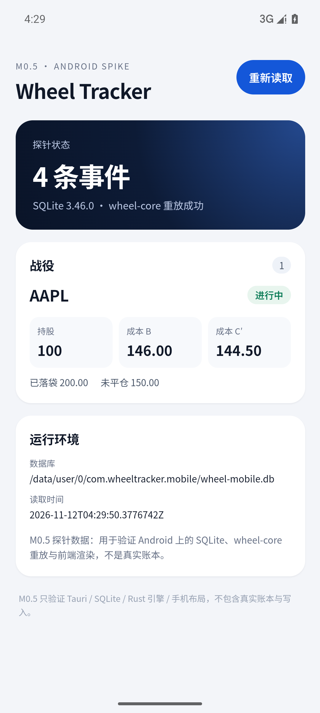
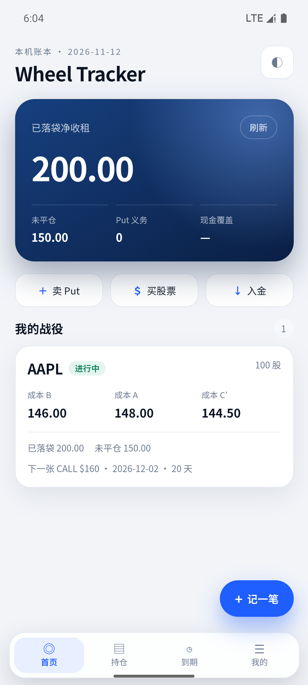

# P11 Android 客户端设计

> 状态：概念稿 + 可交互 Demo（[android-demo.html](android-demo.html)）；M0.5/M1 已完成，M2 记账与合约操作已完成、WebDAV 待接入（见第 12、13 节）· 2026-11-12
> 关联：[P10 WebDAV 备份与导入](P10-webdav.md)

## 0. 定位

手机端不是桌面端的缩略版，而是「口袋里的车轮策略仪表盘 + 10 秒记账器」。

它只做三件事：

1. **看**：所有账户的已落袋、未平仓、Put 义务、现金覆盖，一屏内看完。
2. **记**：卖出 Put / Call、平仓、作废、指派、股票交易，单手 3 步内完成。
3. **处理**：到期前收到提醒，直接平仓 / 作废 / 指派；用 WebDAV 备份与恢复。

完整报表编辑、CSV 列映射、批量导入留在桌面端。

---

## 1. 目标与非目标

### 目标

- 打开 App 1 秒内看到「这个月收了多少租、还有多少义务」。
- 从锁屏通知到处理完一个到期合约 ≤ 15 秒。
- 记一笔卖出 Put ≤ 3 次点击进入表单，≤ 15 秒保存。
- 换机 / 重装后能通过 WebDAV 恢复完整账本。
- 离线可记账；行情失败不阻塞录入。

### 非目标

- ❌ 券商连接、下单、自动同步。
- ❌ 在手机上做完整 Excel/CSV 列映射导入。
- ❌ v1 不做多主实时同步（见 P10 第 10 节）。
- ❌ 不做行情终端；只显示账本参考价与最近报价时间。

---

## 2. 桌面端 11 个入口 → 手机端映射

手机端不保留桌面侧栏，也不把 11 个页面塞进「更多」。按下表重组：

| 桌面端 | 手机端 | 说明 |
|---|---|---|
| 仪表盘 | **首页** Tab | 全部账户 Hero + 战役卡片 |
| 当前持仓 + 全部持仓 | **持仓** Tab | 股票 / 期权分段，支持全部账户与单账户 |
| 全部账户 | 首页账户切换 + 我的 → 账户 | 不单独占一个 Tab |
| 到期处理 + 到期日历 | **到期** Tab | 周条 + 紧急度分组，合并两个入口 |
| 收租台账 | 战役详情 → 交易/收租 | 手机不放大表格，只展示卡片与时间轴 |
| 导入 | 我的 → 导入 | CSV 文件 / 相册截图；复杂映射回桌面 |
| 报告 | 首页快捷 + 我的 → 报告 | 月报柱状图、年度归因 |
| 行情 | 持仓卡片内联 + 下拉刷新 | 独立行情页 v1.1 |
| 设置 | **我的** Tab | 分组列表 |
| 记一笔 | 全局 FAB + 底部抽屉 | 任何页面可呼出 |
| 战役详情 | Push 页 | 成本阶梯、持仓、指派预览、时间轴 |

底部导航只有 4 个 Tab + 1 个 FAB：

```
┌─────────────────────────────────────┐
│                                     │
│              页面内容                │
│                          ┌────────┐ │
│                          │ + 记一笔│ │  ← FAB，拇指可达
│                          └────────┘ │
├─────────────────────────────────────┤
│  首页     持仓     到期     我的     │
└─────────────────────────────────────┘
```

---

## 3. 交互原则

1. **拇指区优先**：主导航、FAB、主操作、保存按钮都在屏幕下半部；删除/恢复等破坏性操作放在抽屉里，不放在右上角。
2. **卡片，不是表格**：桌面端的 `<table>` 在手机上改为「标题 + 两个关键数字 + 状态徽标」的卡片；需要对比时用分段控件切换，不横向滚动大表。
3. **底部抽屉，不是弹窗**：账户切换、记一笔、合约操作、恢复流程都用 Bottom Sheet；桌面式居中 Modal 在手机上显得笨重。
4. **左滑 + 可见入口**：期权卡片左滑露出「平仓 / 作废 / 指派」，同时保留「更多」按钮，保证可发现性与无障碍。
5. **一屏一个主操作**：首页是「查看」，持仓是「处理」，详情底部固定「卖 Call / 记一笔」。
6. **不用纯图标表达关键动作**：图标按钮必须有 `aria-label`；金额、方向、到期日永远带文字。
7. **动效克制**：页面推入 220ms、抽屉 320ms、保存/恢复成功有一次轻反馈；尊重 `prefers-reduced-motion`。
8. **触摸目标 ≥ 48dp**，正文 ≥ 15sp，金额使用等宽数字（tabular-nums）。

---

## 4. 屏幕规格

### 4.1 首页

- 顶部账户 Chip（头像 + 账户名 + 券商）→ 点开账户抽屉（全部账户 / 单账户）。
- Hero 深色卡：已落袋净收租、本月增量、未平仓、Put 义务、现金覆盖率。
- 快捷操作 4 宫格：记一笔、到期、报告、账户。
- 到期提醒卡：例如「3 个合约需要处理」→ 跳到到期 Tab。
- 我的战役：每张卡显示有效成本 B、现价、安全边际、持股、已落袋、下一张合约；附成本阶梯 mini sparkline。
- 下拉刷新报价；行情失败时显示「使用已保存报价」而不是报错弹窗。

### 4.2 战役详情（Push）

- 顶部返回 + 标的 + 更多。
- 有效成本 B 大字；A / B / C′ 三口径。
- 现价 vs 成本、安全边际、成本阶梯图。
- 持仓：股票卡 + 期权卡（平仓 / 作废 / 指派）。
- 「若被 Call 走 / 若被 Put 指派」预览卡：卖出收入、股票成本、已落袋权利金、预计总收益。
- 最近交易时间轴。
- 底部固定操作条：卖 Call（主）+ 记一笔（次）。

### 4.3 持仓

- 分段控件：股票 / 期权。
- 股票卡：股数、有效成本、现价、浮盈金额与比例、市值。
- 期权卡：合约、手数、净权利金、DTE 徽标、到期日、Put 义务；左滑动作。
- 全部账户模式下每张卡带账户标签；单账户模式下隐藏。
- 按 DTE 升序，过期合约置顶并标红。

### 4.4 到期

- 紧急度筛选 Chip：全部 / 已过期 / 今天 / 3 天内 / 提醒期 / 未来 30 天（带数量）。
- 周条日历：周一到周日，今天高亮，有合约的日期带圆点；点日期可筛选。
- 分组列表：每个合约一张卡，显示净权利金、Put 义务、剩余天数。
- 卡内直接「平仓 / 作废 / 指派」，不必先进详情。
- 顶部「检查并发送提醒」：本地通知汇总，不重复提醒同一合约同一阶段。

### 4.5 记一笔（Bottom Sheet）

1. 类型网格：卖出 Put、卖出 Call、买入平仓、到期作废、被指派、股票交易、分红/费用、入金/出金。
2. 表单：标的、行权价、到期日、手数步进器、权利金/股、费用；实时预览净权利金、占用资金、年化。
3. 保存：校验 → 写入 → 关闭抽屉 → 顶部轻提示；失败保留表单并说明原因。

从持仓/到期点「平仓」直接进入预填好的第 2 步，不再选类型。

### 4.6 我的

- 账户卡片：当前账户、券商、账户数、现金。
- 账本：全部账户总览、报告、导入、行情与报价。
- 数据：备份与同步（WebDAV 状态）、导出、重算检查。
- 偏好：外观（浅色/深色/跟随系统）、到期提醒、成本口径、关于。
- 版本与「演示数据」标识。

### 4.7 备份与同步（WebDAV）

- 连接卡：服务商、最后上传时间、本机大小、云端份数。
- 操作：立即备份（加密 + 上传）、从云端恢复。
- 设置：服务器、远程目录、自动备份、加密、仅 Wi-Fi、保留份数。
- 云端快照列表：时间、大小、类型、加密标记、恢复。
- 恢复流程：下载 → 校验（完整性 / 事件数 / 账户数）→ 确认 → 创建本机安全快照 → 替换 → 重新载入。
- 明确提示：同一时间只建议一台设备写入；快照恢复是整库替换，不是同步。

### 4.8 报告

- 月报：12 个月柱状图，点柱子看当月金额；累计净收租、费用、分红。
- 年度：已实现总收益、股票已实现盈亏、按标的归因条形列表。
- 导出入口保留，但不在手机端做复杂列映射。

---

## 5. 移动端特有行为

| 场景 | 方案 |
|---|---|
| 到期提醒 | Android 通知渠道「到期提醒」，每天 09:30 本地时间检查；点通知深链到到期 Tab。v1 在启动/回前台检查，v1.1 用 WorkManager 真后台 |
| 离线 | 账本、报价缓存全本地；写操作离线可提交；网络恢复后补上传 WebDAV |
| 分享导入 | 从相册/文件分享 CSV 或截图到 App；截图走现有 AI 视觉识别，逐行确认 |
| 生物识别 | v1.1 用 BiometricPrompt 解锁，账本敏感，默认关闭 |
| 桌面小组件 | v1.1 2×2 组件：已落袋、下一张到期、现金覆盖；Glance |
| 深色模式 | 跟随系统，金额与红绿语义色在深色下重新取值，不直接反转 |
| 大字体 | 金额和列表支持系统字号放大；不用固定高度卡死文字 |
| 横屏 | 首页/持仓支持两列卡片；录入表单保持单列 |

---

## 6. 技术架构

### 推荐：Tauri 2 Android Shell + 复用 Rust 引擎

```
┌─────────────────────────────────────────────┐
│  Android App (Tauri 2)                      │
│  ┌───────────────────────────────────────┐  │
│  │  移动端 React UI（全新布局，非桌面复用）│  │
│  └───────────────────────────────────────┘  │
│  ┌───────────────────────────────────────┐  │
│  │  wheel-core（纯 Rust 事件引擎）        │  │
│  │  wheel-app 的 store / views / backup   │  │
│  │  rusqlite（bundled） · reqwest(rustls) │  │
│  └───────────────────────────────────────┘  │
│  Kotlin 插件：通知 / WorkManager / SAF      │
└─────────────────────────────────────────────┘
```

- **优点**：账本引擎、schema、备份恢复、报表全部复用；只写一套移动 UI；版本与桌面共用 workspace。
- **代价**：需要 Android SDK/NDK 与 Tauri Android 工具链；WebView 性能不及原生，但本应用以表单和列表为主，足够。
- **关键约束**：`wheel-core` 保持纯逻辑，不引入桌面专属依赖；桌面端的窗口/托盘/更新逻辑不进入移动 target。
- **数据库**：应用私有目录 `wheel.db`，WAL；恢复时关闭连接 → 归档 → 替换 → 重开；崩溃安全仍复用 `restore` 的 pending 标记。
- **凭据**：WebDAV 密码放 Android Keystore / EncryptedSharedPreferences；不写 SQLite。
- **网络**：`reqwest` + rustls；`network_security_config` 禁止明文；自签证书给明确错误。
- **后台**：通知用 `tauri-plugin-notification`（Android 渠道）；真正的周期任务用小型 Kotlin `WorkManager` 插件，不依赖 WebView 常驻。
- **文件**：CSV/备份导入用 SAF（Storage Access Framework），不申请全盘存储权限。
- **发布**：GitHub Actions 增加 Android job（SDK + NDK），签名 APK/AAB；先 GitHub Releases 侧载，稳定后再考虑 Google Play。

### 备选

| 方案 | 评价 |
|---|---|
| Kotlin + Compose + 重写引擎 | 原生体验最好，但把最核心的会计逻辑复制一遍，风险最高，不推荐 |
| Flutter + Rust FFI（flutter_rust_bridge） | UI 表现好，但引入第三套技术栈；团队无 Dart 经验时不划算 |
| React Native + uniffi | 可行，但 Tauri 已能复用现有 React 经验，收益不明显 |

---

## 7. 移动设计系统

- **栅格**：8pt；页面左右 20dp；卡片圆角 18–24dp；列表行高 56dp。
- **字号**：Hero 34–38 / 页面标题 26 / 卡片标题 17 / 正文 14–15 / 辅助 11–12。
- **颜色**：沿用桌面蓝色主色；语义色：
  - 正 `#0C7C57` / 负 `#C92A3E` / 警示 `#A96608`；
  - 深色模式分别提亮，背景用 `#0B0D10` / 卡片 `#14171C`。
- **Hero**：深海军蓝渐变 + 低透明度同心圆，和桌面白色界面形成层次，但仍是同一品牌。
- **图标**：Lucide，20–24dp，1.8 线宽；不使用 emoji 作为功能图标。
- **动效**：标准缓动 `cubic-bezier(.22,.9,.24,1)`；抽屉上滑、页面右进左出、保存成功 Toast。
- **无障碍**：对比度 ≥ 4.5:1；所有图标按钮有文字或 `aria-label`；左滑动作有可见替代入口；支持减少动效。

---

## 8. 里程碑

| 阶段 | 内容 | 预估 |
|---|---|---|
| M0 | 可交互概念稿（本 Demo），验证信息架构与手势 | 已完成 |
| M0.5 | Tauri Android 壳跑通：APK 构建、装机、bundled SQLite + wheel-core 重放、一张手机尺寸页面（见第 12 节） | 已完成 |
| M1 | 真实 `wheel.db`、首页/持仓/到期、深色模式（见第 13 节） | 已完成 |
| M2 | 记一笔抽屉、合约操作已完成；WebDAV 备份/恢复待接入（见第 13 节） | 进行中 |
| M3 | 本地通知、离线、分享导入、生物识别 | 1 周 |
| M4 | 桌面小组件、Play Store 上架材料 | 1–2 周 |

## 9. 验收口径（M2）

- 在 390×844 与 360×800 两种屏幕下，首页首屏能看到 Hero + 到期提醒 + 至少一张战役卡。
- 从首页到保存一笔卖出 Put：FAB → 类型 → 填权利金 → 保存，≤ 4 次点击（不含输入）。
- 期权卡左滑能露出三个动作；不依赖左滑也能通过「更多」完成同样操作。
- 到期 Tab 的紧急度筛选与周条筛选结果一致；过期合约置顶。
- WebDAV 恢复：断网、密码错误、校验失败、成功四条路径都有明确中文提示，且失败不覆盖本机账本。
- 深色模式下所有金额、徽标、图表可读；系统字体放大 1.3× 不截断关键数字。

## 10. Demo 使用说明

打开 [android-demo.html](android-demo.html)：

- 手机浏览器：全屏显示，直接触摸操作。
- 桌面浏览器：显示 390×844 手机框；可点击、左滑、打开底部抽屉。
- 可体验：账户切换、Tab 导航、战役详情、持仓左滑、到期筛选、记一笔两步表单、报告图表、WebDAV 立即备份、云端恢复全流程、浅色/深色切换。
- 数据均为演示值，不写入任何真实账本。

## 11. 开放问题

1. 手机端是否允许写入，还是只读镜像？建议允许写入 + 单写者约定；真正多设备同时写入走 P10 的事件日志方案。
2. 腾讯行情接口在移动网络/海外网络下的可用性与 UA 限制需要实测。
3. 是否上架 Google Play：需要隐私政策、Data Safety 表单、目标 SDK 更新节奏。
4. 平板/折叠屏是否单独布局：M4 之后再评估。

---

## 12. M0.5 技术验证结论（2026-11-12）

目标：在真机/模拟器上证明「Tauri 2 Android 壳 + bundled SQLite + wheel-core 重放 + 前端渲染」这条链路成立。**不含真实账本、写入操作和任何移动端功能页面。**

### 12.1 结论

| 验证项 | 结果 | 证据 |
|---|---|---|
| APK 构建（x86_64 debug） | ✅ | `app-x86_64-debug.apk`，约 136 MB（debug 未裁剪，发布包会小很多） |
| 安装与冷启动 | ✅ | `adb install -r` Success；`am start -W` → `Status: ok`，冷启动 8.3 s（模拟器 + 软件 GPU + debug 包，不代表真机） |
| bundled SQLite 在 Android 上运行 | ✅ | 页面显示 `SQLite 3.46.0`；设备上 `run-as com.wheeltracker.mobile ls -l` 可见 `wheel-mobile.db`（12288 字节） |
| `wheel-core` 在 Android 上重放 | ✅ | 4 条合成事件 → AAPL 战役：持股 100、成本 B 146.00、成本 C′ 144.50、已落袋 200.00、未平仓 150.00 |
| 手机尺寸前端渲染 + IPC | ✅ | 390×844 视口首屏完整显示；`invoke('mobile_probe')` 成功；点「重新读取」时间戳更新，事件数仍为 4（seed 幂等） |
| 运行期错误 | ✅ 无 | logcat 无 panic / AndroidRuntime / FATAL，仅有模拟器系统时钟告警 |
| Rust 单元测试 | ✅ | `probe_seeds_and_replays_a_campaign` 通过 |



### 12.2 工程结构

- `crates/wheel-mobile`：独立 Tauri 2 crate（`staticlib/cdylib/rlib`），只依赖 `wheel-core`、`rusqlite`、`tauri`，桌面窗口/托盘/更新逻辑一概不进移动 target。
- `ui-mobile/`：独立 Vite + React + TypeScript 应用（dev 端口 1421），移动优先样式，不复用桌面 UI。
- 探针命令 `mobile_probe`：打开应用私有目录的 `wheel-mobile.db`（WAL）→ 空库时写 4 条合成事件 → 从 SQLite 读回 → `wheel_core` 重放 → 返回战役口径。页面明确标注「探针数据，不是真实账本」。
- `crates/wheel-mobile/gen/` 为 `tauri android init` 生成的 Gradle 工程，已加入 `.gitignore`，不提交。

### 12.3 本机工具链

- JDK 17（Temurin 17.0.21+9，`G:\dev\jdk-17`）
- Android SDK `G:\dev\Android\Sdk`，NDK 28.2.13676358，`compileSdk/targetSdk 37`，`minSdk 24`
- 模拟器 AVD `Forme_Test_API35`（x86_64，API 35），无窗口模式运行
- Cargo 目标 `x86_64-linux-android`；`rusqlite` bundled 源码随 NDK 交叉编译

### 12.4 Windows 无符号链接权限的绕行

Tauri CLI 在 `tauri android build` 最后一步会把 `.so` 软链到 `gen/android/app/src/main/jniLibs/<abi>/`。本机未开 Windows 开发者模式，软链失败（`Creation symbolic link is not allowed for this system`）。当前做法：

1. 正常执行到软链报错为止（Rust 与前端产物已生成）；
2. 手动复制 `target/x86_64-linux-android/debug/libwheel_mobile_lib.so` 到 `gen/android/app/src/main/jniLibs/x86_64/`；
3. 把 `ui-mobile/dist/*` 复制到 `gen/android/app/src/main/assets/`；
4. 直接调用 `gen/android/gradlew.bat assembleX86_64Debug`。

这是**仅限本机**的绕行：`gen/android` 已被忽略，重新生成后需再做一次。正式方案二选一：开启 Windows 开发者模式，或在 CI 的 Linux runner 上构建（顺带产出 arm64 与 AAB）。

### 12.5 下一步（M1）

- 用真实 `wheel.db` schema 与 `wheel-app` 的 store/views 替换探针，只读打开桌面账本副本。
- 首页/持仓/到期三个 Tab + 深色模式，按第 4 节规格实现。
- 构建矩阵：`arm64-v8a` + `x86_64`，加 release 签名与体积检查。
- 验证 360×800 与系统字体 1.3× 下不截断。
- 决定 Android 构建放本机（开发者模式）还是 GitHub Actions。

---

## 13. M1 / M2 实现记录（2026-11-12）

### 13.1 共享数据层

新增 workspace crate `wheel-store`，把桌面端原先放在 `wheel-app` 里的纯数据代码移出来，桌面与移动共用同一套规则：

| 模块 | 内容 |
|---|---|
| `store` | SQLite schema、事件读写、价格、账户、回放一致性检查 |
| `events` | `NewEventReq` → `Event` 的校验与序号分配（两台设备同一套校验） |
| `views` | 桌面/移动共用的 camelCase DTO、成本卡、持仓、汇总 |
| `market` / `backup` / `restore` / `crypto` | 行情解析、快照、崩溃安全恢复、备份加密 |

`wheel-app` 只保留 Tauri 外壳、窗口/托盘、通知与 WebDAV 编排，并通过 `pub use wheel_store::{…}` 保持原有 `crate::store` 路径不变。`wheel-mobile` 只依赖 `wheel-core` + `wheel-store` + `tauri` + `rusqlite`，不引入窗口/托盘/更新插件。

### 13.2 移动端后端

- 数据库：应用私有目录 `wheel.db`，与桌面同一 schema（`SCHEMA_VERSION = 4`），WAL。
- 命令：`mobile_bootstrap`（账户、今天、库路径、演示标记）、`mobile_overview`（汇总、战役、期权、持股，按到期排序）、`mobile_add_event`（走 `wheel-store::events` 的同一套校验）。
- 首次启动且账户无事件时写入 5 条合成 AAPL 事件（入金 → 卖 Put → 到期 → 买 100 股 → 卖 Call），日期相对安装日生成；一旦有事件就不再写入。
- 写入后立即重新回放，页面数据不经过缓存，账本始终以事件为准。

### 13.3 移动端界面

- 4 个 Tab：首页（Hero + 快捷操作 + 到期提醒 + 战役卡）、持仓（股票/期权分段）、到期（已过期/7 天/30 天/更远筛选 + 平仓/作废/指派）、我的（账户、外观、数据、版本、库路径）。
- FAB「记一笔」底部抽屉：11 种交易类型，期权方向切换、实时净权利金与占用资金预览；从持仓/到期进入时预填合约。
- 深色模式跟随系统，也可手动浅色/深色；金额使用等宽数字；触摸目标 ≥ 44px。

### 13.4 验证结果

| 项目 | 结果 |
|---|---|
| workspace 测试 | 169 通过（wheel-app 89、wheel-store 45+1 ignored、wheel-mobile 2、wheel-core 32） |
| Android 首页 | 演示账本 5 条事件 → 已落袋 200.00、未平仓 150.00、Put 义务 0、AAPL 成本 B 146.00 / C′ 144.50 |
| Android 到期 | 一张 CALL $160 · 20 天后到期，筛选与动作按钮可用 |
| Android 写入 | 记一笔「入金 1000」→ 事件数 5→6，我的页现金 6,550.00（含入金、卖 Put、买股、卖 Call 现金流） |
| 深色模式 | 模拟器与浏览器均验证 |
| APK | x86_64 debug，构建成功；Windows 软链绕行同第 12.4 节 |



### 13.5 尚未完成

- **WebDAV**：桌面端 `webdav.rs` 仍绑定 `AppState` 与 Windows 凭据库，移动端需要先把它抽到 `wheel-store` 并换成可注入的凭据/目录上下文；Android 密码应进 Keystore 或 EncryptedSharedPreferences，绝不写 SQLite。
- **真实账本导入**：目前移动端只会在空库时写演示数据；把桌面 `wheel.db` 导入手机需要 SAF 选择文件 + 校验/覆盖流程。
- **发布**：arm64 构建、release 签名、AAB 与体积检查。
- **通知/后台**：到期提醒仍是 v1 的启动/回前台检查。
